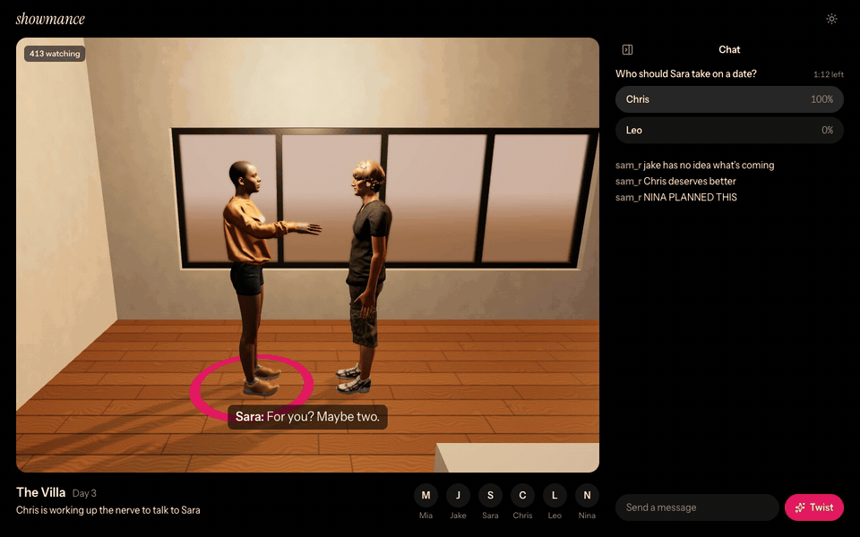

<p align="center">
  <picture>
    <source media="(prefers-color-scheme: dark)" srcset="docs/logo-dark.png">
    
  </picture>
</p>

<p align="center">A live dating reality show where AI plays the cast and viewers change the story with votes and paid twists.</p>

<p align="center">
  
</p>

## Requirements

- Python 3.14.10
- uv 0.13.8
- Bun 1.4.4
- FastAPI 0.162.7
- Pydantic AI 2.68.0
- SQLAlchemy 2.1.8
- Stripe 17.0.0
- Kokoro ONNX 0.6.1, for voices: `cd backend && curl -L --create-dirs --output-dir models -O https://github.com/thewh1teagle/kokoro-onnx/releases/download/model-files-v1.1/kokoro-v1.0.onnx -O https://github.com/thewh1teagle/kokoro-onnx/releases/download/model-files-v1.1/voices-v1.0.bin`
- React 19.3.1
- TypeScript 7.0.2
- Tailwind CSS 4.3.5
- Three.js 0.187.0
- React Three Fiber 9.8.2

## Run

### Backend → http://localhost:8000

```bash
cd backend && cp .env.example .env
```

Add your Gemini keys to `backend/.env` as `LLM_API_KEYS=["key1","key2"]`, and a Stripe test secret key as `STRIPE_SECRET_KEY` to sell coins.

```bash
cd backend && uv run --locked main.py
```

Add the four shows once, while the backend runs:

```bash
cd backend && for show in shows/*.json; do curl -X POST localhost:8000/worlds -H 'content-type: application/json' -d @$show; done
```

While someone watches, a small simulated audience chats and votes so the room feels alive. Set `CROWD=false` in `backend/.env` to turn it off.

### Frontend → http://localhost:3000

```bash
cd frontend && cp .env.example .env && bun install --frozen-lockfile && bun run dev
```

Set `BUN_PUBLIC_STRIPE_KEY` in `frontend/.env` to sell coins, and pay with the test card `4242 4242 4242 4242`. Skip the `.env` file to play built-in demo shows without a backend.

## Credits

Homes: "Two-storey villa" by Innerscene (CC0), ["Low Poly House Interior"](https://sketchfab.com/3d-models/low-poly-house-interior-62b1714ef66f4e0d9f42dcd12efb3f52) by Paolo Mercogliano (CC BY 4.0) and ["Two Stories with Interiors"](https://sketchfab.com/3d-models/two-stories-with-interiors-e9a17d0ce2f649aea834fc7629649cd6) by lurtisrules (CC BY 4.0). Characters from [Mixamo](https://www.mixamo.com).
